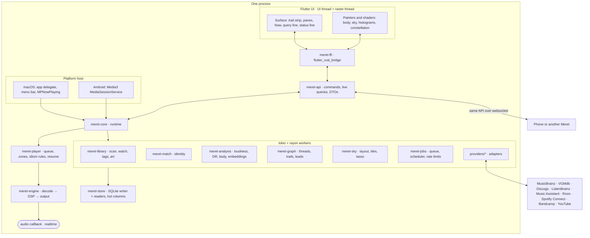

# Architecture

Draft, 2026-10-13. Decided: Flutter over a Rust core, macOS first, Android second, Windows and Linux later. Built for the trails plates ([`design/2026-10-13-trails/`](../design/2026-10-13-trails/index.html)) and the model in [direction.md](direction.md), [idioms.md](idioms.md) and [navigation.md](navigation.md).

## What it has to carry

| Demand | From | What it means for the build |
|---|---|---|
| 120 Hz, never a dropped frame | Panes sliding along a trail, the body turning, the sky panning, brushing a histogram header | The UI thread never waits on the core. Nothing animated asks the core for anything per frame |
| Bit-perfect, gapless, loop-aware | Signal path on every plate; Work and Set idioms; Score loops | A realtime audio thread that owns the device and never allocates, locks or logs |
| Multi-terabyte libraries | 48,210 tracks on the plates; plan for 1,000,000 files across disks and a NAS | Incremental scans, offline volumes kept, and hot columns in memory so the table and the histograms don't touch SQLite |
| Sources everywhere | sp, qb, yt, bc, ia marks; MusicBrainz, VGMdb, Discogs, ListenBrainz threads; Roon, Music Assistant, AirPlay zones | Every integration is an adapter with declared capabilities, and every fact keeps its source |
| Long work, always visible | ↻ analysing 1,204 of 3,880; ≈ 312 to identify | Everything slow is a persistent, resumable job whose state the status line shows |
| Playback outside the window | Plate 10: menu bar, media keys, lock screen | Playback lives in the process, not in the UI. Closing the window or killing the Flutter engine on Android doesn't stop the music |
| Desktop and phone, one library | Plates 03, 08, 11: hand-off, "continue from the Mac at 3:47" | The Mac is the hub; the phone is a satellite with its own copies, and it can control the hub |

## Shape



## Rules

1. **The core owns the truth; the UI draws it.** Library, queue, trails, jobs and source state live in Rust. Dart keeps view state only: scroll offsets, hover, which pane is focused. Dart could be replaced without touching the model.
2. **Three clocks, three kinds of thread.** The audio callback (a deadline every few milliseconds), the UI frame (8.3 ms at 120 Hz), and everything else. They talk through lock-free rings and async channels, never shared locks.
3. **The UI never waits.** Every call into the core is async. A pane opens on the next frame with what it has (the title, the cover, the row count) and fills in. No synchronous FFI call ever happens in `build`.
4. **Animate from anchors, not streams.** The core sends the playhead as an anchor (position, host time, rate) when it changes. Dart extrapolates every vsync. The same goes for job progress (rate and ETA) and the sky (positions sent once as a buffer, after which the GPU does the work).
5. **Bulk data crosses as buffers.** Star positions, histogram bins, sparklines and body summaries arrive as typed arrays (zero-copy `Float32List` and `Uint8List`), not lists of objects.
6. **Slow means job.** Scanning, fingerprinting, matching, analysis, embeddings, sky placement, crawls and syncs are rows in a job table. They're resumable, prioritised, rate-limited per host, and visible in the status line.
7. **Every fact has a source.** Providers emit claims, not rows. A resolver merges them by precedence, and the UI can always say where a credit or thread came from and how sure Meret is (`≈`).
8. **Playback never depends on the UI.** The core is a process-wide singleton started by the platform host. The Flutter view attaches to it and can go away.

## Crates

One Cargo workspace. The arrows are the only allowed dependencies; `meret-engine` in particular never sees the store.

```
meret-model ◄── everything        pure types: IDs, entities, idioms, threads, availability, signal path
meret-query ◄── store, core       the query language: parser and AST, no IO
meret-store ◄── library, match, analysis, graph, sky, jobs, core
meret-engine ◄── core             realtime audio; depends on model only
meret-player ◄── provider, core   queue, zones, idiom playback rules, resume; doesn't know the engine
meret-provider ◄── providers/*, core
meret-core ◄── api                composes the runtime
meret-api ◄── ffi, cli, (server)  the one public surface
```

| Crate | Owns | Notes |
|---|---|---|
| `meret-model` | Typed IDs, the entity graph (work, recording, release, edition, track, agent, context, source), idioms and their playback rules, thread kinds, provenance, availability and identity marks, the signal path | No IO. Everything else speaks these types |
| `meret-query` | `sung:"Joanne Hogg" not:owned`, `idiom:session year:1970s plays:0`, `last:30d`, plus the commands (`play`, `want`, `crate add`) | Smart crates are saved queries, so the parser is shared by search, crates and the table |
| `meret-store` | SQLite schema and migrations; one writer thread that batches transactions; a pool of readers; the **hot column store**; FTS5 search | See *Storage* |
| `meret-library` | Roots (volumes), the stat walk, diffs, move detection, FSEvents resume, tag reading, CUE sheets, rip logs, artwork extraction and the light tokens; writing tags and moving files to match the store, as undoable jobs ([stories.md](stories.md)) | Offline volumes are marked, never deleted |
| `meret-match` | Identity: MBID tag → ISRC → AcoustID → fuzzy, with method and confidence kept | Below the threshold a match is `≈` |
| `meret-analysis` | EBU R128 loudness, dynamic range, tempo and key, structure, the **body summary** (what the radial drawing is made of), audio embeddings | Runs on the hub; phones receive results |
| `meret-graph` | Threads (typed, sourced edges), trails as trees (branch, peek, meet, prune), leads and how they converge | The product's heart, and almost all pure logic, so it's tested hardest |
| `meret-sky` | Stable placement from embeddings, level-of-detail tiles, star buffers for the GPU, lasso | New stars settle in; old ones don't move |
| `meret-jobs` | Persistent queue, resource classes (IO, CPU, network per host), token buckets, pausing on battery or while playing | MusicBrainz allows one request a second, so this is not optional |
| `meret-engine` | Decoders, gapless joins, loops, DSP stages, output backends, the playback clock | See *Audio* |
| `meret-player` | Queue, trail and tree playback, idiom rules (never shuffle inside a work), resume per idiom (plate 09), zones | A local engine, a Roon zone and a Sonos room are all `Zone`s; `meret-core` wraps the engine as the local one |
| `meret-provider` | Capability traits, the registry, claims, an HTTP context with rate limits, cache and keychain | One crate per service under `providers/` |
| `meret-core` | Starts and wires everything; live-query invalidation; the status snapshot | The process singleton |
| `meret-api` | Commands, live queries and DTOs for panes, lists, Now, the status line and the sky | Transport-agnostic: FFI on device, websocket from a phone |
| `meret-ffi` | flutter_rust_bridge bindings over `meret-api` | Built by the Flutter build; not in the default workspace members |
| `meret-cli` | `meret scan`, `meret query`, `meret decode`, `meret play` | For exercising the core without a UI |

## Storage

**SQLite in WAL mode, one writer.** A writer thread owns the only write connection and batches work into transactions, so a scan inserting thousands of rows a second doesn't contend with anything. Readers come from a pool. The schema is in [`crates/meret-store/migrations/`](../crates/meret-store/migrations/).

| File | Holds | Rebuildable? |
|---|---|---|
| `library.db` | Entities, files, sources, threads, provenance, listens, notes, trails, crates, wants, jobs, FTS | No: it holds your trails and notes |
| `cache.db` | Provider responses (HTTP cache), crawl results | Yes |
| `embeddings.f16` | One vector per track, memory-mapped, plus an HNSW index | Yes, by re-analysis |
| `sky.bin` | Placed positions and LOD tiles | Partly: positions are part of your memory of the map, so they're backed up |
| `art/` | Content-addressed covers at 64, 128, 256 and 512 px, with OKLCH light tokens precomputed | Yes |

**Hot columns.** The table pane and the histogram headers can't round-trip through SQL at 120 Hz. The store keeps a struct-of-arrays copy of the columns you sort, filter and brush (release, artist, album artist, case-insensitive title/artist/album ranks, idiom, year, length, format, DR, plays, last played, added, availability), about 64 bytes a track, or 64 MB for a million. Name ranks are computed while loading and the strings are then dropped. Filters produce roaring bitmaps, and facet counts scan the matching row numbers. Brushing *Last played*, recounting the year histogram and the idiom facets over a million rows took 3 ms in a release build on this Mac before the browsing columns were added (`cargo test -p meret-store --release -- --ignored --nocapture`).

**Lists are handles.** The core caches each `(query, view)` as track IDs in display order plus display items: track ordinals and, when grouped, release headers. Sort keys are library, title, artist, album, year, length and format; ties stay in library order even descending. Group sorting moves whole releases, never their disc/track order. The UI pages display items; playback starts from a track ordinal in that same view. Release labels and artwork are read in batches for each page.

**Column browser.** Idiom → person → release facets count tracks over the query's non-browser clauses, then its idioms, then its people. A track counts once for its artist and once for a different album artist. Clicking a new entry clears that column and downstream selections; clicking a selected entry removes only its clause. Counts, selected flags, and canonical entry/All queries come from the core. `meret library ls '' --group --sort year --desc` and `meret library facets 'idiom:score'` expose the same API without the UI.

**Sync-ready from day one.** Library rows carry a `rev` taken from a global counter, so a phone can pull "everything since *rev*". Things you make (listens, notes, trails, crates, wants, resume points) have ULIDs and merge rules. Trails are append-only trees, so merging them is a union.

## Audio

```
source ─► decoder ─► [resampler] ─► DSP stages ─► ring ─► output callback ─► device
 file      Symphonia   only when       ReplayGain,   SPSC     CoreAudio HAL
 stream    libgme,      the device      EQ,           rtrb     AAudio
 zone      vgmstream,   can't take      crossfeed
           FFmpeg       the rate
```

- **Samples travel as `i32` in a left-justified 32-bit container,** so 16- and 24-bit PCM and DoP-packed DSD pass through untouched. A stage that needs float converts internally and says so in the signal path.
- **The callback only reads the ring.** Control comes in on a second SPSC queue. Position goes out through two atomics (frames played, host time). Nothing in the callback allocates, locks, logs or calls into Dart.
- **Gapless.** Decoders report encoder delay and padding. The engine opens the next source a few seconds early and splices it into the same stream. A change of sample rate means reopening the device for bit-perfect output; that gap is unavoidable, and the signal path shows it.
- **Ramps only at edges.** The CoreAudio callback fades 8 ms in when the device starts or resumes, after a seek's flush and after an underrun, and 8 ms out before a pause stops the device (the pause waits for it, 60 ms at most). Those are already discontinuities; between them samples pass untouched, so the ramps leave `● Bit-perfect` true. Opening a device skips the physical-format set when it already runs that format, and closing one restores it only if it changed.
- **Loops.** Score sources expose loop points (native formats, vgmstream metadata, or detected). Each idiom has a `LoopPolicy`: intro, loop ×2, fade; or loop forever.
- **macOS output** goes straight to the CoreAudio HAL rather than through cpal: hog mode, setting the nominal sample rate, choosing the physical stream format. **Android** uses AAudio (exclusive, MMAP where offered), plus Android 14's bit-perfect mixer attributes for USB DACs, which have to be set from Kotlin.
- **The signal path is data.** Every stage describes itself and whether it changes the samples, so `● Bit-perfect` is computed, not asserted.
- **Zones.** `meret-player` drives anything that implements `Zone`: the local engine, a Roon zone, a Music Assistant player (Sonos, AirPlay, Chromecast), Spotify Connect, or another Meret. Each zone reports its fidelity (bit-perfect, resampled above 48 kHz, lossy, delayed about 2 s), which is the PLAY ON list on plate 09.

## UI (Flutter)

```
apps/meret/lib/
  core/      the bridge: CoreBridge interface, the Rust implementation, a fake for building without Rust
  shell/     surface, trail strip, pane row, query line, status line, width classes
  panes/     one widget per pane kind: person, release, group, work, table, sky, tree, front
  now/       Now: body, signal path, up next, pick up
  draw/      painters: body, constellation, histogram header, sparkline, availability marks
  theme/     instrument tokens, light tokens from the cover, idiom registers
shaders/     sky.frag (density), body.frag   (planned)
```

- **Width classes, not platforms**, from navigation.md's scaling table: phone (one pane, swipe along the trail), foldable (two), laptop (two or three plus a narrow Now), large (four or five, spines, a pinned Now).
- **The pane row is a `Flow`.** Sliding panes and folding them to spines changes only paint transforms, never layout. Each pane sits in a `RepaintBoundary`.
- **The body and the playhead repaint without rebuilding.** A `PlayheadClock` ticks on vsync only while playing and extrapolates from the core's anchor. Painters take it as `repaint:`, so nothing above them rebuilds.
- **Lists are virtual with fixed extents.** Rows come from the core in pages through a small cache. Covers are decoded off the UI thread at the size they're drawn.
- **The sky is the GPU's job.** Positions arrive once as a `Float32List` and are drawn with `drawRawPoints` or `drawVertices`. A fragment shader draws the density at galaxy zoom, and tiles take over as you zoom in. A lasso is a polygon sent to the core, which returns a selection.
- **Keyboard first on desktop.** `Shortcuts` and `Actions` carry navigation.md's keys: `/`, `[` `]`, `⌥[` `⌥]`, `⌘↵`, `T`, `M`, `W`, `C`, `⌘S`, Space, `⇧Space`.
- **Words are labels, data and keys.** No sentence explains what a control does, what a section holds or what is planned; a door that isn't built says "Coming later", and a state gets one short line at most (an absent output: "Using the system default"). Decided 2026-10-18.
- **Platform glue stays native.** On the Mac: the menu bar item, `MPNowPlayingInfoCenter` and media keys in `macos/Runner/Outside.swift`, the panel in `PanelView.swift`, and window lifetime in `AppDelegate.swift` and `MainFlutterWindow.swift`; `shell/outside.dart` feeds them Now and carries commands to the core. On Android: a planned Media3 `MediaSessionService` in Kotlin that talks to the same Rust engine directly, so playback survives the Flutter engine being torn down.

## Integrations

A provider declares which of these it can do. The registry asks by capability, so a new service is one crate and one line in the registry.

| Capability | Gives | First providers |
|---|---|---|
| `Catalog` | Claims about entities: titles, credits, editions, external IDs | MusicBrainz, VGMdb, Discogs, Open Opus |
| `ThreadSource` | Typed, sourced relations to follow | MusicBrainz, VGMdb, Discogs, Wikidata, ListenBrainz |
| `LibrarySync` | What you own or saved elsewhere, with a cursor | Spotify, Bandcamp, YouTube likes, Qobuz |
| `StreamSource` | Bytes Meret can decode itself | Bandcamp downloads, Internet Archive, podcast feeds |
| `ZoneHost` | Zones Meret can drive but not decode for | Music Assistant, Roon, Spotify Connect |
| `ListenHistory` | Import and scrobble | ListenBrainz, Last.fm |
| `Shop` | Watches wants | Bandcamp, Qobuz, Discogs marketplace |
| `Crawler` | Candidates for leads | YouTube, Bandcamp, SoundCloud |

Each provider gets a `ProviderContext`: an HTTP client with that host's rate limit and a response cache, a key-value store for cursors, the keychain for tokens, and a way to emit claims and edges. Its health goes to the status line. The claim model means a provider never writes the library directly, so a bad provider can be switched off and its claims dropped without damage.

Later, the same traits can be exposed to out-of-process plugins (a WASM component or a subprocess speaking `meret-api`). Nothing is built for that yet; keeping providers behind claims and capabilities keeps it possible.

## Hub and satellites

- **The Mac is the hub.** It holds the whole library, runs analysis and providers, and serves `meret-api` over a websocket on the LAN (mDNS) or a tailnet.
- **The phone is a satellite.** It replicates library metadata by `rev`, keeps its own copies of what you've put on it, plays them through its own engine, and controls the hub's zones for everything else. With no hub it runs as a hub of one.
- **Hand-off** moves the queue and the anchor. The phone plays its own copy if it has one, or controls the Mac if it doesn't (plate 10).
- **Your data merges.** Listens are append-only, trails are unions of trees, and crates and notes are last-writer-wins per field.

## Budgets

These are what a spike or a regression test should hold the build to.

| What | Budget |
|---|---|
| Cold start to Now drawn | 400 ms, from saved state; no scan on the way |
| Opening a pane | First frame on the next vsync; filled within 50 ms at p95 |
| Scrolling the table, 1,000,000 rows | 120 Hz on an M-series Mac and a mid-range 120 Hz Android phone |
| Brushing a histogram, 1,000,000 rows | Recount within 4 ms |
| Search as you type | 30 ms at p95 |
| Sky, 1,000,000 stars | Pan and zoom at 120 Hz |
| Playing FLAC, window hidden | Under 1% CPU on an M-series Mac |
| Rescan of an unchanged 1,000,000-file library | Seconds via FSEvents resume; under 60 s by full stat walk on SSD |
| Core memory, 1,000,000 tracks | Under 400 MB on desktop |

## State of the scaffold

As of 2026-10-23. `cargo test --workspace` runs 225 tests (plus three ignored: a benchmark, and a device listing and an unplug test that need hardware); `flutter test` in `apps/meret` runs 205, ten of them through the real Rust core (parsing and commands, scan to play, the Front, search, grouped rows and facets, release and person panes on a trail, device volume, and a pick counted through).

| Works | Stubbed or missing |
|---|---|
| Query language: parse, canonical form for searches and commands, errors; the planner answers column clauses from bitmaps. Free text, people (`by:`, and the role keys) and `release:`, `work:` and `game:` go to full-text search or the credits: a word matches where a word starts, ignoring case and accents ("iona" finds Iona Brown, not "traditional"; "olafsson" finds Ólafsson). Exact case-insensitive agent names, release titles and work titles take precedence over contains matches. `composer:` matches a recording's composers and its work's (so an arrangement of Beethoven is `composer:beethoven`), `performer:` the artist tag and PERFORMER, `sung:` performers whose instrument is a voice, and `arranged:`, `lyrics:`, `conducted:`, `produced:` and `engineer:` their tags; `work:` matches a work or the work a movement belongs to. `play <query>` runs from the query line | Games, films, labels, wants, dormant and BPM match nothing until something in the library says them; `member:` waits for MusicBrainz. `queue`, `want` and `crate` say they aren't built yet |
| Store: schema v15, migrations, settings (the light level, the output device and mode, and the lookup answer) through the writer, a device id minted on first use (every row a person makes carries it), the single writer (a write returns once its batch has committed), readers, hot columns loaded from SQLite at start-up and after every scan, one row per track in library order (album artist, album, disc, track), with histograms and cascaded idiom/person/release facets; the FTS5 trigram `search` table, kept by the scan and backfilled by migration 0003; the last six query/view lists held by the core, sorted and optionally grouped, then paged. Migration 0006 merges tracks that are copies of one another into one track with several sources; migration 0007 splits joint credits into people, both without a rescan. Memory (slice B, 2026-10-17): every playback attempt is a `listen` row (started at, played ms, the trail stop it came from); a play counts when it ran for half the length or four minutes, whichever is less, and `plays`/`last played` in the hot columns count only those, updated in place once a listen crosses that line. How far the open listen got is written with every queue checkpoint and as the app quits (`flush_memory`, from Flutter's exit request), so quitting or crashing mid-track keeps it. Migration 0008 adds `queue_state` (the queue, cursor, position and playing flag as JSON, checkpointed every ten seconds while playing and at once on pause or stop) beside the `resume` table (one row per release partway through, cleared when it plays to the end). Migration 0009 persists trails: stops, parents, threads, dwell, pruning, actions, names, kept and the history order. Migration 0010 saves the open listen with the queue; resuming that queue after a restart continues the listen rather than counting a second play. Migration 0011 adds `root.fsevents_uuid`, the FSEvents database a root's event id belongs to. Migration 0012 adds `work.composer_credit`, and marks every file changed and every root unwatched once, so the next launch walks and re-reads all of them for the new tags. Migration 0013 adds `edge.detail`, one edge per pair and kind, and `work.recording_count` for lookups; 0014 gives `external_id` a provenance, NULL for tags, so an ID a lookup or a match gave is told apart from one the tags carry; 0015 adds the `game` table (title, year, developers, platforms, series) and renames the job kind to `lookups`, one queue for every provider. The `job` table is a queue: new keys queue, an existing queued job takes the higher priority, the highest-priority due job runs first, and a running job left by a quit queues again at start-up. `cache.db` keeps provider responses, 200s and 404s, and is rebuilt when broken | A hot-column snapshot file for a faster cold start; live-query invalidation; a word-prefix index, so a one- or two-letter search doesn't scan the table |
| Engine: Symphonia decode, the ring, gapless joins, reopening on a format change, seeks that flush, anchors, the signal path. CoreAudio HAL output: device list, hog mode, rate switching, integer physical formats, restoring the device on close, latency-corrected anchors. Devices match by UID only. Meret shares the device with macOS unless exclusive mode is on (decided 2026-10-22): macOS only sends the volume keys to its default output and moves that default away from a hogged device, ignoring any attempt to set it back, so in exclusive mode the keys change another device. Shared, the nominal rate still follows the source and the keys work as they do for any app. With the system default chosen, the device is resolved once when playback starts and kept for every reopen until playback stops or the setting changes, because macOS moves its default output away from a hogged device. A chosen device that is absent when a session starts is stood in for by the system default; the choice is kept, Play on rings the device in use, and a resume while paused goes back to the chosen device once it is present. A device that goes away mid-session (`kAudioDevicePropertyDeviceIsAlive`) pauses playback where it stopped, with "<device> disconnected" in Now; the buffered ring waits, and a resume plays it on the chosen device if it is back and otherwise on the system default, which opens only then. Lossy sources report 24 bits, so exclusive mode doesn't pick a 16-bit format for them. Output changes apply at once when idle and on resume when paused. The device's own volume (`kAudioDevicePropertyVolumeScalar`, master or per channel) and mute are read, and the volume set, from Now; setting it unmutes, and samples are never scaled. Listeners on the open device's volume and mute send `VolumeChanged`, so Now carries the volume the keys or Control Centre set | A resampler for rates the device can't do; releasing hog mode during a long pause; the system volume keys in exclusive mode, which follow macOS's moved default; loops; DSD, libgme, vgmstream; dither |
| Library: parallel stat walk, diff with move detection confirmed by a head hash, tags through lofty. Scans run on a background worker and write roots, files, sources, recordings, tracks, releases and credits through the writer in batches of 256. A file whose release already has a track with the same disc, number and normalised title (or, without numbers, the same title within 2 s) becomes another source of that track, so the Tyranny soundtrack's FLAC and MP3 folders are 43 tracks with two copies each; a title that repeats the track number ("1 - Terratus") loses the prefix. Playback and the format column use the best present copy (lossless, then depth, then rate; lossy by bitrate, then Opus, AAC, Vorbis, MP3; lowest source id on a tie), and `format:` matches any copy. Artist and album artist credits keep the written string for display and sorting, and credit each person: multi-value tags first, otherwise split on `;` and *feat.* always, and on `&`, *and* and commas only when every part has two or more words, so "Simon & Garfunkel" and "Gibbons, Orlando" stay whole. The other roles come from COMPOSER, LYRICIST, ARRANGER, CONDUCTOR, PERFORMER ("Joji Hirota (shakuhachi)" keeps the instrument), PRODUCER, ENGINEER and MIXER, split the same way; a part of more than six words, or "unknown" and "composer unknown", names no one, so a note in a credit tag doesn't become a person. WORK, MOVEMENTNAME and MOVEMENT make works, found again by title, parent and written composer; a work's composer is ORIGINAL_COMPOSER (read from Vorbis comments) when the file has one, since then COMPOSER is whoever wrote the arrangement, and COMPOSER otherwise. MusicBrainz recording, release, release group, work and artist IDs (an artist's only when there is one per person), ISRCs, LABEL and CATALOGNUMBER are kept for lookups. Missing files and unplugged roots are marked, never deleted; unreadable files are retried on the next scan. Each release gets a first idiom from cheap signals (chiptune formats and `.m4b`, genre tags, tracks over 40 minutes), or Album with `idiom_source = 'default'`, which any signal replaces. Covers and their light tokens are read after each root scan. FSEvents on macOS: a full walk records the event id and the FSEvents database UUID it started at (`root.fsevents_id`, `fsevents_uuid`); at launch the roots with a matching UUID replay the volume's history since the oldest id instead of walking, and the rest are walked. The replay is one batch, and requests queued after it (the CLI's settle among them) wait for it, falling back to walking every root after 10 s. While Meret runs, changes are gathered until 0.7 s pass quietly (5 s at most), then only the changed folders are walked again, recursively, against the files the store has under them; a change in the root folder itself, a mount or unmount, or wrapped ids walk the root. Each batch moves every walked root's id forward; adding or removing a root restarts the stream from the last id. Removing a folder marks its root removed and hides its tracks everywhere; adding it again restores the same tracks. Suggested folders for the empty Front: `~/Music`, Steam soundtracks, an Apple Music media folder outside `~/Music`, and mounted volumes Finder shows, counted within a two-second budget, except paths macOS would ask about, which aren't walked until you add them | CUE sheets; ORIGINAL_COMPOSER outside Vorbis comments; works that disappear from every file stay in the table; MusicBrainz genres and local audio classification for idioms; surname-first names ("Gibbons, Orlando") are kept as written, not reordered; Android's file watching |
| Trails as trees: follow, branch, peek, meet, prune, depth-first play; leads converge. The API drives them: a search or a Front door starts one, a pane's threads follow from the stop it was picked in (a branch when that isn't the last), `[` `]` walk the branch and a star on the strip jumps to its stop. Following a thread to something already on the current path goes back to that stop instead of adding one, and `]` never lands on a folded peek. Starting a trail keeps the old one: `[` at a root steps back into the previous trail at the stop you left it from, and `]` there returns to the newer trail. Every trail survives a restart, written after each move; the history comes back with no active trail, so Meret opens to the Front and `[` steps into the newest trail where it was left. `keep_trail` marks and names the whole tree; `trail_history` lists summaries ("Root → Leaf", stops, branches, when, kept, played, wanted) for the Front. Local threads come from tags: *by* (artist), *album artist*, *on* (a release someone is on), *worked with* (people sharing a release, in any role), *composed by*, *lyrics by*, *arranged by*, *performed by*, *conducted by*, *produced by* and *engineered by* (each with the tracks, and a performer's instrument), *recording of* (a track or a movement to its work), and *matched* from a search to a hit. MusicBrainz threads (slice H): *member of* and *has member* between people and groups, *worked with* from collaborations, and performers, producers, engineers, arrangers, conductors and works from recording lookups, each sourced MB; following a thread keeps its source on the strip. Release pages (tracklist with each track's work, formats, credits with the tracks each artist and each other role is on), person pages (their releases, other people's they're on, the releases of each other role they have, the works they wrote, who they worked with, and every track they're on in any role) and work pages (the composer, the work it's part of, its parts, every recording you have, release by release, and its plays; `play_work` plays from a row). In the UI (slice J): a pane you forked from lists "Forks here", each branch with its leaf, the thread into it, when and what was done on it, a click going to it and `prune` on a branch with nothing done on it; a thread already followed off this branch reads `⑂ → where it led`; `⌥[` `⌥]` switch to the neighbouring branch at the nearest fork, landing where you last were on it; `⌘⌫` prunes the newest prunable branch; the strip plays this branch (root to here) or the whole tree depth first, each release, work or game once. `T` toggles the tree pane (plate 07, without the sky): the trail's dates, name and counts, Name it, Play this branch, Play the whole tree and Keep, the whole tree drawn with each stop's time and what was done on it, peeks as ticks and meetings dotted, then a table of branches (from where, stops, when, what happened, state) and folded peeks; a node or a row opens that stop in the panes, and `prune` hides a branch with nothing done on it. `meret library trails` and `library walk '['` read the saved history, and walk steps `{` `}`, `go=N`, `prune=N`, `wait=S`, `play` and `play-tree` drive the same calls | The tree on the sky; threads from providers other than MusicBrainz and Wikidata; the sky's "close neighbours" for meetings |
| Player: per-idiom resume (plate 09), shuffle that never splits a work; the queue driving any `Zone`, one item loaded ahead for gapless joins; `LocalZone` over the engine, playing each track's best copy and setting device volume; Now with title and artist; next (at the queue's end, stop) and previous (more than three seconds in, by the extrapolated anchor, it restarts the item; otherwise the one before), both stepping past items the zone can't open; the queue after the playing item as Up next. Memory: on start the saved queue is described into Now as paused at its position without opening the device; `Resume` then plays it at the idiom's point (album, song, session from the top of the track; score and set the exact second; spoken five seconds back), `FromStart` from the top of the item, and `pick_up(release)` any release partway through, listed by `resume_points`; `history`, `most_played(days)` and `dormant` (five counted plays, none in 180 days) read the listens. `meret library resume`, `library now` and `library history` show them; the CLI's `play` checkpoints before exiting on Ctrl-C. Play something (slice E): `picks` ranks releases from listens and trails alone, each with its why in the core's words: dormant first ("Dormant · 2 years: 96 plays, then nothing for 2 years"), then a release one of the last five trails reached but you never played through ("From your latest trail" / "From a recent trail"), then never-played releases rotating by the day so the CLI and the app agree all day; every pick says how it will play by idiom ("The whole score, in order", "The whole date, in order") and its tracks, length and format; `play_something` queues the first from the top with the why on every item, and Now carries it (`NowDto.why`) until something else plays. Play on: `zones` lists this machine's output devices with a verdict from the settings (bit-perfect; shared with macOS when exclusive mode is off; refuses above N kHz for a device that can't run high rates, since there's no resampler) and `play_on` switches output as Settings does. `library picks` and `library zones` print them | Queues longer than 10,000 rows; habits, leads and the sky as pick sources; zones beyond this machine (Roon, Music Assistant, Spotify Connect, a phone) |
| Matching, sky placement and lasso, job scheduling and rate limits; the persistent job runner for lookups. Analysis (slice K): every recording with a present file is an `analysis` job, run by half the cores at utility QoS (one while something plays); the best copy is decoded once and streamed through EBU R128 integrated loudness and true peak (`ebur128`), DR by the TT meter's method and the body summary (240 bins of loudness and three bands), in constant memory, into the `analysis` row; an edition whose tracks are all analysed gets the rounded mean DR. The hot columns are patched in place per job (`dr` per track, a new `loudness` column, `lufs:` queries with negative ranges) and tables refetch at most once a second; the status line shows `analysing`. Playback can level loudness (Off, Track, Album) to -18 LUFS with true peak kept under -1 dBTP, a gain on the decode side that the signal path reports as `levelled`. On a copy of the real library, 844 tracks took 56 s in a release build with none failing | AcoustID, embeddings, tempo, key and sections, LOD tiles; scans still run outside the `job` table on their own worker |
| Providers: capability traits, claims, rate-limited HTTP with a response cache (a cached answer spends no request). MusicBrainz lookups (slice H): nothing is sent until you allow it, from Needs you or Settings › Lookups. Then every MusicBrainz ID the tags carry is a job (releases, then recordings with a track, then people the tags credit, then works), and so is every release without an ID, matched by album title and album artist after those. A match searches by words and then insists: the same title once case, punctuation and quote marks are set aside; one of the album artists among the credited names, with sort names turned round and initials ignored ("Justin E. Bell" is Justin Bell); at least your track count and no more than a quarter more; and one release group, or one with exactly your count. The match's ID carries the search score as its confidence, and the release is then looked up, but its tracks pair with MusicBrainz's by title rather than position (where a title names one track on each side), since a matched release may be laid out differently; one thread runs them a request a second, retries what failed to connect after 30 s, doubling to an hour, six tries in all, and stops on not found. A release lookup gives its tracks' recordings and its people their IDs by position and by count, as the scan does with ID tags, and fills a missing label and catalogue number; a recording lookup adds performers (with instruments), producers, engineers, arrangers and conductors, and the work it's of; an artist lookup adds groups, members and collaborators, as people with no tracks when they aren't in the library; a work lookup adds its composer and the recordings of it you don't have (100 at most), kept off the table and out of search. Tags win: a lookup never repeats a credit the tags give, and never replaces a label, a work or an ID. Lookups go only one step past your tags; opening a person, release or work with an ID puts its lookup first, which is how a band reached by *member of* gets its members. `meret library lookups [allow\|off]` answers and waits for the queue Wikidata games (slice I): every release marked a score or an album gets a job after the MusicBrainz ones. Its title loses its soundtrack words ("Tyranny Official Soundtrack (Deluxe Edition)" is Tyranny), then its last part ("Sid Meier's Civilization V: America" is Civilization V), and Wikidata's entity search is asked for video games by each name in turn. A game whose name or alias is the name, roman numerals as digits, wins over one whose name only starts with it; either must be the only one, or the only one sharing a composer with the release. An album whose title doesn't say soundtrack needs that shared composer too. The game keeps its title, year, developers, platforms and series; the release gets a *soundtrack of* thread to it; its composers become credits on the game, matched to your people by name; and a release that was an Album only because nothing said otherwise becomes a Score (idiom source `game`), which tables and facets pick up at once | Matching by recording (AcoustID) and by title alone; showing that an ID came from a match; VGMdb (its JSON mirror is gone and vgmdb.net answers scripts with a Cloudflare challenge, 2026-10-22); films; ListenBrainz and every other provider; Music Assistant is a shell |
| Flutter: the surface, width classes (Now is a bar below 1400 px and a pinned pane from there: 360 px to 1800, 380 beyond; decided 2026-10-17), the `Flow` pane row (plate 01, slice D): the Front is a page of its own, never a pane beside a trail; with a trail open the row holds the current branch's panes, as many as fit at 440 px each (300 below 1000 px wide) up to the width class's cap (3 on a laptop or desk, 5 large), older stops folding to 46 px spines (the stop's name written upwards, its thread beneath; a click returns to it) that keep their pane's scroll, selection and focus for the unfold; panes share the width equally, except that a search's table takes what the others don't need past 560 px; a search pane's header is one line, `Search · query`; the query line (on macOS also the window's title bar; a command runs). **Opening state** (plate 09, slice C): the first Now the core sends decides once. With a restored queue Meret opens to the Now stage: `Now · paused`, the dial, title, "Paused Sat 08:58 at 0:19 of 7:31 · on This Mac", a Resume button (`Space`; `⌥Space` from the start), Pick up (every release partway through, with the idiom's rule, "Score · the cue where it stopped", a progress bar, position and day), What was that? (the last four listens with times and "paused at", "skipped at", "played through"), and Up next; from 1000 px the Front sits dimmed at the stage's left, 560 px at most, headed "Front". The stage leaves on `⌘1`, any door, search or `[`, and is not re-entered that session; with nothing to resume Meret opens to the Front full width. `H` opens the history sheet (200 listens; a row opens its release). The panes after the Front are the trail's current branch, nothing else: a search, a Front door or `⌘L` starts a trail, every pane opened from a pane follows a thread from that pane's stop (a branch when it isn't the last), `[` `]` walk the branch (`[` at a root steps into the previous trail, or shows the Front when there is none) and a star on the strip goes to its stop. The strip names every stop and the thread into it, with other branches in grey below and forks ringed; stops that reach the same thing are joined by a dotted line, and a deep trail scrolls sideways, keeping 44 px stars at least 144 px apart and the current stop in view, with arrows when more lies off either edge. With no trail open the strip says `[ to resume Tuesday's · <title> · N stops`, naming the newest saved trail, or `no trail yet`; `⌘S` asks for a name and keeps the open trail's whole tree (an empty name keeps it unnamed, under its title), and the strip marks a kept trail with ◆ and its name. While the query line has focus it owns every printable key: `/`, `[`, `]`, `h`, Space and `⇧Space` are typed, not routed; Escape dismisses the hits, then leaves the field; held keys never repeat an action. Moving along the trail slides the panes in from the side you came from and does nothing at the end of a branch; the Now stage crossfades into the trail or the Front; Now's scroll survives the pinned-to-bar switch. Typing a search drops grouped hits under the query line (people, releases, tracks, and "All N tracks"), moved through with the arrows; `↵` opens a search pane (the result's table under a strip of its people and releases); a person or release hit opens its pane, and a track plays from its row in the result. In any table the album cell opens the release and the artist cell the person; `⌘↵` opens the selected row's release. A release pane: idiom, year, tracks, discs, length and formats (the best copy, then "also MP3"), Play, the written credit with each person in it openable, credits (each album artist, then each track artist with the tracks they're on, then each other role with its tracks and instrument, minus a role a *by* line already says for the same tracks; a fold after eight) and the tracklist, which plays from a clicked row and links each track's work under its title. A person pane: their releases, other people's they're on (joint credits included), a section for each other role they have (Composed, Arranged, Performed and the rest), the works they wrote, and who they worked with, each a thread. A work pane: the composer, the work it's part of and its parts as threads, Play, and every recording you have with its artist and release, which plays from a clicked row and opens the release from its album line. The status line with scan progress. Now: playing or paused, the title, previous, play or pause and next (off until something has been queued), the time, a seek bar that re-anchors the clock on release, a bare dial (minute ticks, the played arc, the hand) with the cover at its centre, the signal path, Up next (the queue after the playing item, eight rows and "N more", refetched when the item changes, "then stop" at the end), Pick up and What was that? (three rows each, the lower half scrolling) and the device's volume (disabled with the reason when the device has none); the Now bar carries the transport, the title, and from 560 px the seek bar and from 760 the volume, and its title opens the full pane as a sheet; brushable histogram headers. The Front from real data: the collection by idiom and by format (each format line counts its own door's query, so a track with a FLAC and an MP3 copy is in both Lossless and Lossy; Unknown format counts best copies and has no door), added lately (each opens its release), needs you, folders, and an add-folder door when the library is empty; every line with a query starts a trail at it. The Front remembers (plate 02, slice C): a third column from 1200 px (appended to the second below that) with Kept trails (or, with none kept, Trails: the newest four and "⌘S keeps a trail"; a row reopens the trail where it was left), Pick up (a row resumes that release the way its idiom does), Your log (seven weekday bars of listening time, today marked), Most played this week and Dormant (a row opens the release); each shows only when it has rows, and the quiet outlines for Leads and Crates close the column. Memory sections refetch after every trail move, keep and item change; the collection refetches on the library version as before. The table pane (plate 04) with paged rows from the core: the idiom → people → releases column browser across the top, whose entries write the query; grouped by release by default, each group a header with its 18 px cover, track count, album artist, year, length and formats; headers that sort ascending, descending, then back to library order, with numbers in names compared by value; the playing row lit; Enter or a double-click to play from the row in the order shown, and adding a music folder. The light: whatever is playing lends its cover's clamped colour to the playing rows, the progress line and the body, and brass otherwise; the release pane shows its cover. `⌘1` shows the Front over an open trail, headed `Front · ⌘1 back to <trail>`, and, pressed again, the trail where it was; `]` from that Front returns too. The trail stays open behind the Front (its strip stays, `⌘S` still keeps it), because the Front never ends a trail. Release and person panes carry a plays fact (`212 plays · last Tuesday`, from counted listens) and the release pane an actions row: Play in gold, then Want (`W`) and Crate (`C`) greyed with "Coming later" on hover. **Play something and Play on** (plate 09, slice E): Now's stage, pinned pane and bar sheet list the core's three picks under "Or play something", each a cell with its label, title, reason, plan and meta, the first marked in gold; `⇧Space` plays the first, `Space` does the same when there's nothing to resume (otherwise it toggles), and a click plays that pick; all three keys are typed while the query line has focus. While a pick plays, Now shows the core's why in gold under the subtitle and Up next stops repeating it. "Play on" lists the zones with a ring on the current one and the verdict in ok or warning colour; a click switches output, and the marker follows a change made in Settings while Now is open. Playing a pick or switching a zone never touches the trail or the Front. Setup ([stories.md](stories.md)): the empty Front offers the folders Meret found, a folder picker, Connect a service and a Bring your history placeholder, beside outlines of Leads, Crates and trails, and Pick up; Settings (`⌘,` or the app menu) is a window-styled panel over the surface with Folders (add, remove), Sources, Playback (output device and exclusive mode, applied at once when idle, on resume when paused and otherwise from the next track; device volume), Lookups, Files, History, Devices and Light (off, accent, accent and wash); a source or the scan in the status line opens a popover with its state and Open in Settings. MusicBrainz (slice H): Needs you asks once, `MusicBrainz lookups` with what the tags would send (IDs, album titles and album artists) and how many releases would be matched by name, Allow and Not now; Settings › Lookups switches it and counts what's looked up, waiting and failed, releases matched by name and those still without an ID; the status line item says asks first, off, looking up, offline or N looked up, with a `looking up` job while the queue runs; person panes list Member of and Members, work panes Other recordings (with how many MusicBrainz knows), and release, person and work panes refetch as lookups land, while tables don't. Games (slice I): release panes have a Game section and person panes a Games section; a game pane shows the year, developers, platforms and series, then Composers, Soundtracks and Same series, then the soundtracks' tracks, playable from any row. The Needs you line and Settings › Lookups say what goes to MusicBrainz and what to Wikidata. `MERET_DATA=<dir>` at launch opens that library instead of the real one, for smoke runs on a copy | Contexts, crates and leads as panes; leads and crates on the Front; folder rows and Up next rows as doors; `T`, `⌘↵` follow, `⌥[` `⌥]`; the phone and foldable layouts (query line at the bottom); in the table, grouping by work or person, columns that follow the idiom, plays sparklines, and a brushed histogram that adds its clause instead of replacing the pane's query; covers on the Front; the body summary in Now's dial; keys for previous and next; the sky; fonts; Media3 glue |
| macOS host (plate 10, slice F): a menu bar status item with the ring-and-dot mark, the loaded title (truncated past 32 characters) and elapsed time; without a loaded item, only the mark. Its native panel has the cover, title, subtitle, a pick's why, a clickable seek line, previous, play/pause and next, elapsed and total time, a This Mac label, the signal-path verdict or playback error, up to three pick-up rows (cover, release and credit, track or position), Play something and Open Meret. Hidden `NSMenuItem` key equivalents make `⇧Space` and `⌘O` work while the panel is open. Dart pushes every Now through `meret/outside`, and pushes pick-up rows initially and when the item or play state changes; opening the menu fetches nothing. Swift extrapolates the anchor and updates the time once a second while playing. `MPNowPlayingInfoCenter` receives title, subtitle as artist, elapsed time, rate, duration and artwork; the first loaded Now claims `.playing` once before publishing the actual state, so F8 can resume a paused launch rather than opening Music. Remote commands and media keys route play, pause, toggle, next, previous and position changes through Dart to the core; play or toggle with nothing loaded starts Play something. Closing dismisses Settings first or exits full screen; otherwise it hides the window without stopping playback or the Flutter engine. The Dock or Open Meret brings it back; `⌘Q` quits | Android's Media3 service |

**UX pass, 2026-10-23** (a QA round over first launch, motion, moving around, width, Now and keys; supersedes the rows above where they differ):

- *Window.* The first launch opens at 1440×900, or what fits the screen, centred; afterwards the frame is autosaved (`MeretMain`); the content never goes below 600×480.
- *Motion.* One duration, `kMotion` = 200 ms. Trail steps (a thread, `[`, `]`, a star, a spine) slide the panes with `easeOutCubic`; pages (the Front over a trail, the tree, the Now stage to the trail or the Front) fade through: the outgoing page is gone by 100 ms, the incoming one shows from 100 to 200, so two layouts never overlap. `]` or `⌘1` back to the trail fades like `[` or `⌘1` away. The pane row is always mounted; the Front and the tree are overlays above it.
- *Nothing is thrown away.* Stops that leave the path stay mounted offstage (the last six, at their last width), so stepping back and forward, a star, a spine or `⌘1` and back show the same pane with its data, scroll and selection. Release, person, work and game panes refetch in place when lookups land and show "Reading …" only with nothing loaded; a release, work or game pane shows its stop's title over that placeholder.
- *First launch.* The welcome headline waits for the folder look ("Looking for music folders…", then "Meret found N places with music" counting only places with a file count, else "Start with a music folder"); the places Meret found stay listed under Folders after one is added; Connect a service sits in the Coming later box with Bring your history; the quiet Leads, Crates and Pick up panels say Coming later. "Not now" on the Lookups prompt hides it for this run and leaves the setting unasked; only Settings sets Off. Format bars are shares of the sum of the format counts. Doors tint `panel2` on hover and `line` while pressed, and thread rows, tracklist rows and outlined pane actions hover the same way.
- *Now.* One voice for moments, `dayAndTime`: "just now", "today 06:28", "yesterday 21:57", "Thu 21:57" within a week, else the date; positions always read "m:ss of m:ss". The stage shows the idiom's rule under Resume ("Album · from the top of the track") from the resume point it will apply; the loaded item is not repeated in Pick up; Play something never offers the release loaded in the queue; a resume point exists only where something is partway (position > 0, or a track after the first). The verdict names the stage that altered the sound ("◐ Altered · shared with macOS"); Up next is a section like Pick up with "N tracks"; the pinned pane reserves the why line's two-line slot so the transport never jumps; the bar's play button plays something when nothing is loaded, and the title slot says "Nothing to play yet" when there is nothing; the stage dial is sized from the stage width; the Now sheet fits the window less 32 px; Space toggles inside the Now and history sheets and `h` closes the history sheet. The status item's title dims while paused.
- *Keys and hints.* The status line's hints are state-true (`␣ pause` while playing) and never overflow (one ellipsised line); `⌘1 Front` and `⌘L table` show from 1000 px; Tab does nothing on the surface; `⌘S` works while typing like the other chords; the focus reclaim never fires under a sheet; the Escape that releases the query line empties it, and an unfocused line never promises `↵`. Before the first Now arrives nothing is drawn in the strip or the bar.
- *Strip.* Stop labels take the room between neighbouring stars (minus 24 px, 128–240; the tree 190–240); the strip has no scrollbar, only its pager; with no trail open the `[ to resume …` line is a door that steps into that trail. The lookup counter's total is the batch's high-water mark of done + pending, so it converges.
- *Open after this round (need a decision).* At 1400–1559 px the pinned Now leaves the Front two columns and a three-stop trail two panes, fewer than at 1399 (pin from 1560, or let desk panes go to 340 px?); `]` at a re-entered trail's root prefers the next trail in history over the stop's own branches; strip lane labels overprint the main line when two lanes share a half; nothing re-enters the Now stage once left; the strip does not tween; Settings keeps Material's dropdown and switch.

Covers come from the first present track's embedded front picture (or its first picture), then from its folder: `cover`, `folder`, `front`, `album`, `albumart`, then the first JPEG or PNG by name. Reading and rendering happen in parallel, outside the store writer; each chunk commits together. Original bytes determine the blake3 name in `art/`, with JPEGs at 64, 128, 256 and 512 px on the long edge, never upscaled. A release checked without a cover is not read again until a new or changed track is ingested; unchanged rescans write no art. The 64 px image feeds hue buckets in OKLab: the winning chroma-weighted colour is restrained to lightness 0.68–0.80 and chroma at most 0.14, gamut-mapped to sRGB, with wash and dim alpha 0x14 and 0x55. Grey or pale covers keep the instrument accent. Release pages and Now carry cover paths; Now also carries track and release ids and the light tokens. `meret library rescan` reports cover reads and new files, including the startup scan.

Measured so far: through the MacBook Pro speakers, 16/44.1 and 24/96 FLAC play bit-perfect (the speakers switch to 96 kHz and back to 48 afterwards), 8 s of audio takes 8.3 s of wall clock including the device open, and sends 2–5 anchors; the null output sends **one** for a 6-second file; decoding runs at 1,200–2,600× real time; the core cross-compiles for `aarch64-linux-android`. Scanning 928 files (3.7 GB, mostly AAC and Vorbis) into an empty store takes 0.1 s, and rescanning them unchanged takes 9 ms. A page of 50 rows comes back in about 0.1 ms. Through the Studio Display speakers, six tracks of a 16/44.1 FLAC album played through the queue, bit-perfect in hog mode. Every join came as Ended then Started, and the device started each track within 0.02 ms of the previous one's last frame (−0.24 ms after a full 82-second track, inside the anchors' 2 ms tolerance). There was no reopen and no gap.

Output routing, 2026-10-17, on the Studio Display: with the system default chosen and exclusive mode on, playing the Tyranny release through the core alternated MP3 and FLAC copies (both 44.1 kHz), and each change of source format reopened the device. While Meret held the Studio Display, macOS moved its default output to the MacBook Pro speakers, so a reopen that looked up the default again moved playback to them, and the volume keys controlled the speakers instead of the display. Keeping the device chosen when playback starts fixed the routing: every reopen stayed on the Studio Display. Its volume reads and sets in steps (0.24 reads back as 0.2383). With the copies merged, the same release opens the device once.

Search, on the 1,014-track library: each keystroke's hits come back in 0.1–7 ms, the slowest being the first letter. On a synthetic million-row `search` table, a word of three or more letters takes 0.15–0.33 s when it matches a third of the rows and less as it gets rarer; a one- or two-letter word scans the table in about 0.43 s.

## Working on it

```
cargo test --workspace                       # the core
cargo run -p meret-cli --release -- decode some.flac
cargo run -p meret-cli --release -- devices
cargo run -p meret-cli --release -- play some.flac          # default device, shared; --exclusive (hog mode), --device UID, --null --speed 20
cargo run -p meret-cli --release -- scan ~/Music --stat-only

# The library, through meret-api. --data defaults to the app's own directory
# (~/Library/Application Support/io.sowilo.meret), so the CLI and the app share one library.
cargo run -p meret-cli --release -- library add ~/Music            # scan a root into the store, with progress
cargo run -p meret-cli --release -- library ls 'year:1990s' --limit 20
cargo run -p meret-cli --release -- library front                 # the Front as text: idioms, formats, added lately, needs you
cargo run -p meret-cli --release -- library search 'baldur gate'   # the query line's hits, timing every prefix as if typed
cargo run -p meret-cli --release -- library walk 'civ' 0 1          # open hit 0, then that pane's thread 1; prints each pane and the trail
cargo run -p meret-cli --release -- library walk 'civ' 0 search=iona '[' ']'   # a second trail, then back into the first and forward again
cargo run -p meret-cli --release -- library volume [0.4]          # read, or set, the output device's own volume
cargo run -p meret-cli --release -- library play 'format:flac' --from 3 --count 5 --tail 6   # times every join
cargo run -p meret-cli --release -- library history            # every listen, newest first, ✓ when it counted as a play
cargo run -p meret-cli --release -- library resume             # releases partway through, with the recording and position
cargo run -p meret-cli --release -- library now                # Now as the app would open it: paused at the saved position
cargo run -p meret-cli --release -- library trails             # saved trails, newest first; `library walk '['` steps into the last
cargo run -p meret-cli --release -- library picks              # Play something's picks, best first, each with its why
cargo run -p meret-cli --release -- library zones              # Play on: this Mac's outputs, the current one starred, with verdicts

cd apps/meret
flutter test                                 # bridge tests need: cargo build -p meret-ffi
flutter run -d macos --dart-define=MERET_FAKE=true   # mock data, no Rust
flutter_rust_bridge_codegen generate         # after changing crates/meret-ffi/src/api
```

`library play` prints Started and Ended in the order the engine sent them. For each join it also prints the gap between where the device put the last frame of one track and the first frame of the next, worked out from the anchors. `--tail N` seeks into each track's last N seconds, so an album's joins can be heard in a minute.

The macOS app isn't sandboxed (decided 2026-10-13). Like most audiophile players sold outside the App Store, it reads music folders anywhere directly, so there are no security-scoped bookmarks to keep. The folder picker is `file_selector`.

Each debug rebuild re-signs the app, so macOS asks again whether it may access the Music library. The startup scan waits on that prompt, and the status line shows "scanning 0 of 0" until it's answered.

Building the app needs Xcode on macOS and a JDK on Android. CocoaPods is not needed. `apps/meret/hook/build.dart` is a native-assets build hook: it compiles `crates/meret-ffi` for whichever target Flutter asks for, and Flutter bundles the library. Plugins come through Swift Package Manager (`enable-swift-package-manager` in the pubspec). The hook requires a pinned toolchain, so `rust-toolchain.toml` names an exact version. `crates/meret-ffi/rust-toolchain.toml` is a symlink to it; bump the version there.

## Licences to watch

Fine for personal use; they matter before distributing anything.

| Dependency | Licence | Note |
|---|---|---|
| Essentia | AGPL-3.0 | Its trained models are CC BY-NC-SA. Keep it behind a feature flag or replace it |
| libgme | LGPL | Dynamic linking |
| FFmpeg | LGPL or GPL by build | Fallback decoder only, behind a feature flag |
| Chromaprint | LGPL | `rusty-chromaprint` is an MIT port |

## Order of work

Completed steps below record the sequence of development, not necessarily the current interface. See [State of the scaffold](#state-of-the-scaffold) for implementation status.

1. **Spikes, to test the decisions.** (a) Flutter: a million-row virtual table, 100,000 stars and the body painter, measured in DevTools on a ProMotion Mac and a 120 Hz Android phone. (b) The engine: gapless FLAC through the CoreAudio HAL with hog mode and rate switching. The engine side is done, including a gapless album through the queue on a real device; a USB DAC still has to prove integer formats. These two gate the stack.
2. **The iTunes core.** Done. Library, store, hot columns, the table pane, local playback and the transport on the Mac work end to end, and the roots follow FSEvents.

   Getting from an empty window to the music you want comes next, in four slices (decided 2026-10-13). Each ends with something usable and adds one way in:

   1. **A shell with only real content.** Done. The real core shows no placeholder panes. With nothing to resume, Meret opens to the Front, and the Front shows only what the library can answer: the collection by idiom and by format, added lately, needs you (unreadable and untagged files), and a door to add a folder. Idioms come from cheap signals at scan time: chiptune formats, genre tags, and tracks over 40 minutes. The trail strip starts at "Front · no trail yet", and the query line runs searches.
   2. **Search.** Done. The scan fills the FTS5 `search` table. The planner answers text clauses from it and intersects them with the column bitmaps. Typing shows people, releases and tracks as you type, grouped by kind, and `↵` opens a search pane that starts a trail.
   3. **Release and person panes.** Done. A row or a hit opens a release (tracklist, edition, format, play) or a person (releases by role) to the right, and the trail records it. Threads come from local credits only for now: *by*, *album artist*, *on*.
   4. **Browsing like iTunes.** Done. Rows grouped by release, sorting by column, and an artist → album column browser over facet counts. Cover art is read during the scan, and it also feeds the light.

   Then the UX plan of 2026-10-17, in slices: **A** transport, seek and Up next in Now, pinned from 1400 px (done); **B** memory in the core: listens, resume and the queue, trails across restarts (done); **C** Meret opens to Now paused where you left it, with Pick up, What was that? and Up next, the Front gains Kept trails, Pick up, Your log, Most played and Dormant, ⌘S keeps a trail, ⌥Space starts from the top and H opens the history (done); **D** the pane row as plate 01 draws it: the Front behind ⌘1 when a trail is open, spines, pane facts and actions (done); **E** Play something (⇧Space) with its why, and Play on (done; picks come from listens and trails until habits, leads and the sky exist, and the zones are this Mac's outputs); **F** the menu bar item and media keys (done).
3. **Trails.** Panes, threads from MusicBrainz and VGMdb, trees, the Front. In slices (proposed 2026-10-21):

   - **G** credits and works from tags: composers, lyricists, arrangers, performers with their instruments, conductors, producers and engineers; works and movements, with ORIGINAL_COMPOSER as the work's composer when an arrangement credits someone else; MusicBrainz IDs, ISRCs, labels and catalogue numbers kept for lookups; role threads on release panes, role sections and works on person panes, and a work pane; the role keys and `work:` answer (done).
   - **H** MusicBrainz as jobs: the persistent job runner in the status line, lookups for MBID-tagged recordings, releases and artists, cached; *member of*, *worked with* and other recordings of a work as threads, sourced "MB" (done), then releases without IDs matched by album title and album artist (done).
   - **I** games for scores, from Wikidata rather than VGMdb, which scripts can't reach: the game a soundtrack is of, its developers, platforms, series and composers, a game pane, *soundtrack of*, *scored* and *same series* threads, and `game:` (done).
   - **J** trees in the UI: forks inside panes (⑂, "Forks here"), `⌥[` `⌥]`, prune, and playing the tree (done).
4. **Analysis and the sky.** Loudness, DR, the body, embeddings, placement, leads. In slices (proposed 2026-10-22):

   - **K** analysis as jobs: R128 loudness, true peak, DR and the body summary for every track; DR and LUFS columns, histograms and queries; the body drawn from real data; loudness levelling (done).
   - **L** embeddings, once the model is chosen: one vector per track, *sounds like*, meetings by neighbours.
   - **M** the sky: stable placement, the sky pane, lasso, the trail and the tree on the sky.
   - **N** leads that converge, feeding the Front and Play something.
5. **Android.** AAudio, the Media3 service, the satellite sync, hand-off.
6. **The rest of the integrations.** Music Assistant, Roon, Spotify Connect, ListenBrainz, Bandcamp, YouTube.

## Open

1. Does the phone replicate the whole library's metadata (around 1 GB for a million tracks), or only what it holds plus what you've recently touched?
2. Is remote playback from the hub to the phone (streaming the Mac's files, transcoded when off Wi-Fi) in scope, or only control plus local copies?
3. Which embedding model? It decides `sounds like`, the sky and the licence story.
4. Where do backups go? Trails, notes and sky positions are irreplaceable; the rest can be rebuilt.
