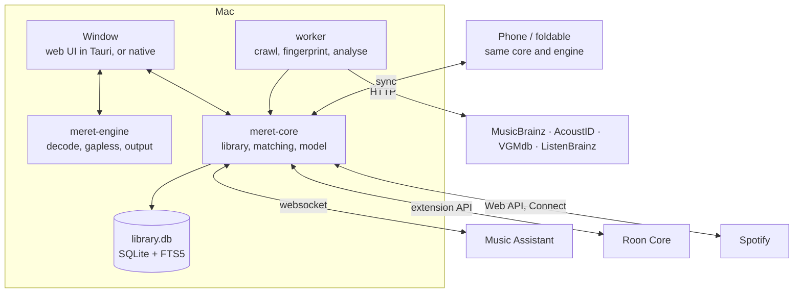

# Direction

> **Historical design notes.** This first-pass exploration includes superseded stack choices and unimplemented proposals. [Architecture](architecture.md) documents the chosen stack and current implementation.

First pass, 2026-10-13. Most of this is still open. The name is **Meret**, the Egyptian goddess of song and rejoicing, "the beloved", who in some creation accounts sets the cosmos in order with music. It was "Clio" until 2026-10-13.

Plates are in `design/`, which stays local; renders of the main ones are in [plates.md](plates.md). Serve them with `python3 -m http.server -d design`, or use the `plates` entry in `.claude/launch.json`.

## What it is

A local music player for one person's library that can also reach the services they already pay for. The library is the hub; Spotify, Music Assistant, Roon and the rest are sources and outputs, not the centre. Desktop first, then phones and foldables.

## Its own thing

Meret borrows a few ideas from Tessera and none of its look. The ideas:

- **Recordings under a work, compared and never merged.** Gould 1955 and Gould 1981 are two readings of BWV 988. Covers, arrangements and re-orchestrated game themes have the same shape.
- **Depth stops.** Line (transport, lock screen), Plate (now playing), Sheet (the release or work), Full (credits, lineage, every source).
- **Truthful state.** Meret says when output is resampled or lossy, how a track was matched, and when a source is unavailable.
- **A Rust core owning SQLite, with long work done as jobs.**

### Leading direction: the listening sky (2026-10-13)

Sol liked B's planetary system as a starting point, though not its name (orrery belongs to Tessera), its thin type or its density. A and C read as too skeuomorphic. Plates: `design/2026-10-13-spheres/`.

The idea is a notebook of observed sound. Leonardo drew things to find out how they worked; music's counterpart is the tradition of seeing sound (Kepler's *Harmonices Mundi*, Chladni's figures, Fludd's monochord). Meret, who orders the cosmos with music, is the same idea told as myth.

- **Compass and ruler.** Everything is drawn with circles, arcs and leader lines. Light is the only material: no texture, bevels or paper.
- **Lettered figures.** A, B and C on a drawing are keyed to notes beside it. Your own notes use the same key, pinned to a time or a body.
- **Four zooms.** Galaxy (the library placed by audio similarity, sized by plays, with the week's trail and found-but-not-owned stars), Constellation, System (a release: tracks as orbits, lineage as chords), Body (a track: time clockwise, layers as rings, loudness at the edge). Each zoom is its own drawing. A Ledger table is one toggle away at every level, which is how it scales.
- **Podcasts fit the same grammar.** A show is a system of episodes, an episode is a body whose rings are chapters, and the transcript is its marginalia.
- **Type:** Instrument Sans and Geist Mono, at working weights.

Navigation (2026-10-13): trails of panes joined by threads, with one top line (query, LCD, activity; 2026-10-23) in place of tabs, a sidebar and a status line. See [navigation.md](navigation.md).

Earlier candidates, kept for reference:

The look comes from objects that belong to music rather than to reading. Three candidates, each drawn on the same Outer Wilds screen in `design/2026-10-13-directions/`:

| Direction | Form taken from | Type | Where the album's colour goes |
|---|---|---|---|
| A · Faceplate | Hi-fi gear: VFD display, engraved wide capitals, LEDs, hardware keys | Archivo (wide for labels), Doto dot matrix for readouts | The knob and the lit key. The VFD's cyan stays fixed |
| B · Orrery | A planetary system: tracks are orbits out from the cover, planet size is length, the playing planet moves | Jost, DM Mono | The glow round the cover and the playing orbit |
| C · Liner | The CD as an object: a shelf of spines, an obi strip, liner-note typesetting | Schibsted Grotesk, Martian Mono | The obi strip, which also gives the spine shelf its colours |

They can mix: B's orrery as the now-playing plate on a phone, C's spine shelf as the dense library view, A's readout as the transport. A serif such as Piazzolla could come back only for classical work titles, the one place where engraved-score lettering belongs.

The earlier plates in `design/2026-10-13-first-light/` were Tessera with the nouns swapped. They're kept for the strip comparison of recordings (plate 01) and the clamping rules for album colour (plate 03), which still apply in any direction.

## The model

MusicBrainz's model is the right spine, because classical music and soundtracks both need the gap between a *work* and a *recording* of it.

| Entity | Meaning | Popular | Classical | Game / film |
|---|---|---|---|---|
| Work | The composition | Usually 1:1 with a song | The unit people think in: BWV 988, its parts (movements, variations) | The theme: Travelers, which recurs across tracks |
| Recording | One performance captured | The track | A performer's reading, with date and venue | The OST cue, an arrangement or a cover |
| Release | A published set | The album | Often a compilation of works | The soundtrack, a vinyl, a Bandcamp edition |
| Credit | Who did what | Artist | Composer, performer, conductor, ensemble | Composer, arranger, plus developer and game |
| **Context** | Where it is heard | — | — | The area, scene or boss it plays under. Meret-only, from VGMdb, wikis or your own notes |
| **Source** | Where the bytes come from | A file, a Spotify URI, a Music Assistant item, a Roon browse path. One recording can have several | | |
| **Listen** | A play | Yours, imported from Last.fm or ListenBrainz and logged from then on | | |

Identity. A recording is one thing even when it comes from three sources. Matching order: MusicBrainz ID in tags, then ISRC, then AcoustID fingerprint, then fuzzy metadata. Meret stores and shows how each match was made.

**Unmatched is a place, not an error.** Obscure music lives there. From it Meret can seed MusicBrainz's release editor (MusicBrainz accepts a pre-filled form; you review and submit on their site) using your tags, fingerprints and VGMdb's track list.

## Sources

| Source | What it gives | The catch |
|---|---|---|
| Local files | Everything, bit-perfect, gapless | Tagging and matching are on us |
| Music Assistant | One websocket API over many providers (Spotify, Tidal, Qobuz, YouTube Music, Plex, Jellyfin, Subsonic and more) and many players (AirPlay, Chromecast, Sonos, Snapcast) | Needs its server running. Its players do the playback, so "play here" depends on what it supports for the local machine |
| Spotify | Library, playlists, recently played, search, Spotify Connect control | Since November 2024 the Web API gives new apps no recommendations, related artists, audio features or audio analysis. Development-mode apps are capped to a few users, which is fine for one person. The Web Playback SDK needs Widevine, which macOS's WKWebView lacks, so a Tauri window can't play Spotify audio itself; it can drive Connect, or go through Music Assistant. As far as I know SongDNA and its credits data aren't in the public API |
| Roon | Zones, transport and browse through the extension API | Its rich credits and reviews are licensed and shown in Roon's own app. Treat Roon as a zone and a browse source, not a metadata source |
| YouTube / YouTube Music | Likes, history, playlists, and uploads of things no catalog has | No official YouTube Music API. Unofficial clients use your browser session; the YouTube Data API covers likes and playlists within a quota. Personal use only |
| Bandcamp | Purchases and downloads | No fan API; collection pages via your session |
| Last.fm / ListenBrainz | Listen history, similar artists, ListenBrainz's open recommendations | — |

Check every service's terms again before building against it. They changed twice in the last two years.

## SongDNA and Roon's depth, from open data

- **Lineage:** MusicBrainz relationships (samples, covers, "performance of" a work, arrangements, instruments, producers), Discogs credits and Wikidata. Meret draws these as one graph per work or recording.
- **Game and film music:** VGMdb has the catalog numbers, track lists and arrangers. It has no official API, its community JSON mirror (vgmdb.info) is gone, and vgmdb.net answers scripts with a Cloudflare challenge (checked 2026-10-22). Wikidata has the games themselves: names, years, developers, platforms, series and composers.
- **Audio features Spotify stopped giving out:** analyse locally. Essentia covers tempo, key, loudness and trained mood and genre classifiers. An audio-embedding model gives "sounds like" by nearest neighbour.
- **Obscure tastes:** this is the main argument for local embeddings. Collaborative filtering only knows what many people played; audio similarity works for a rip nobody else has. The crawl (YouTube, Bandcamp, SoundCloud) collects candidates; embeddings rank them against what you actually play.

## Architecture sketch

| Area | Leaning | Why | What would overturn it |
|---|---|---|---|
| Core | Rust library, SQLite | Proven in Tessera. 50k tracks plus a relationship graph is a small database | Nothing likely |
| Audio engine | Rust: Symphonia for decoding, CoreAudio output on macOS with sample-rate switching for bit-perfect, AAudio on Android | Gapless matters for classical and for continuous game OSTs. A web audio element can't do bit-perfect or reliable gapless | A spike where FFmpeg or libmpv is clearly less work for the formats you actually own |
| UI | **Open.** Web UI (Solid, Svelte or similar) in Tauri on desktop is the front-runner | The dense, typographic sheet is natural in CSS, and the plates are already HTML. Solid was right for Tessera's editor; a music app's hot paths are long virtual lists, a 60 fps transport and canvas drawing (strips, the ring), which any fine-grained framework handles | Mobile. See below |
| Mobile shell | Native media session per platform, whatever renders the UI | Background playback, lock-screen and Bluetooth controls, and audio focus need Android's MediaSessionService and iOS's AVAudioSession. Tauri doesn't provide them, so each platform needs a native plugin around the Rust engine | If those plugins grow large, a native UI per platform (Compose, SwiftUI) over the shared Rust core may cost less than a WebView |
| Providers | One adapter per service; Music Assistant as the shortcut to most streaming services | Avoids writing Tidal, Qobuz and YouTube Music clients early | If Music Assistant's own player can't play on this machine |

## Theming: the instrument and the light

The chrome is a fixed instrument. Whatever is playing lends it one light: up to three tokens (`--light`, `--light-wash`, `--light-dim`) taken from the cover in OKLCH and clamped into a band that reads on the background. Text, structure and status colours never take the light. Pale or grey covers, which covers most classical releases, fall back to the instrument's own accent rather than forcing a tint. Each direction above places the light somewhere different.

Settings could offer three levels: off, accent only, accent and wash. A fuller per-album theme stays possible later because the light is already isolated in tokens.

## Density by platform

| Surface | Default depth | Layout |
|---|---|---|
| Desktop, 1440 | Sheet | Sidebar, one or two panes with an apparatus margin, transport along the bottom |
| Foldable, unfolded | Sheet + Plate | Work on one side, now playing on the other |
| Phone, foldable cover | Plate | Now playing, one gesture from Sheet |
| Lock screen, widget, watch | Line | Title, part, time |

On touch, targets grow to 32 px and rows to 36 px, as in Tessera.

## Open questions

1. **Player or controller?** Does the phone need to play your local files itself, or mostly control zones (Music Assistant, Roon, Connect) and handle the Mac's library remotely? The answer decides how much of the engine goes to mobile early.
2. **Where does the library live?** A Mac hub with phones syncing, like Tessera, or a Music Assistant server as the hub?
3. **Does Meret share notes with Tessera?** Listening notes could be Tessera blocks that cite a recording, as Tessera cites a passage.
4. **How far does theming go?** Accent only, or should some albums be allowed to take over the sheet?
5. **The name: Meret** (decided 2026-10-13). "Clio" collided with the legal-software company and pointed at history rather than wandering. Meret matches Tessera and Umran: short, unfamiliar, and carrying a whole concept. Her role in creation is attested only in some accounts; her firmer association is with song and rejoicing.
   Rejected along the way: Zij, Tarab, Asterism, Almagest, Ephemeris, Rihla and Sama (Sol wanted nothing Arabic, since Umran already is); Errant, Albedo, Peregrine, Sidereal, Ecliptic and Weft (not thematic enough); Tessitura (too close to Tessera); Musurgia (a lovely concept, a bad name); Hathor, Linnunrata, Väinö, Vegtam and Arion.

## First spikes

1. **Engine:** gapless FLAC through Symphonia and CoreAudio in a Tauri window. Measure gaps between parts, CPU at idle, and sample-rate switching.
2. **Matching:** run tags, AcoustID and MusicBrainz over a sample of your most obscure folder. Measure how much ends up unmatched; that number shapes the Unmatched surface.
3. **Music Assistant:** connect to its websocket, list providers, search across them, and play to a player. Find out whether it can play on the Mac itself.
4. **Similarity:** Essentia features plus one embedding model on about 1,000 tracks. Check whether "sounds like" is any good for game soundtracks.
