# Design plates

The plates are static HTML mockups with drawn covers and mock data. They live in `design/`, which Git ignores; the images below are renders of them at their native sizes. The built app follows the plates but differs where building it changed a decision, and [navigation.md](navigation.md) and [architecture.md](architecture.md) record those changes.

With the plates checked out locally, serve them with `python3 -m http.server -d design`, or use the `plates` entry in `.claude/launch.json`.

| Set | Date | What it covers | Doc |
|---|---|---|---|
| `2026-10-23-navigation` | 2026-10-23 | Home, a trail with its threads drawn, motion, the top line, a day of trails | [navigation.md](navigation.md) |
| `2026-10-14-setup` | 2026-10-14 | First launch, Settings, sources, writing back to files | [stories.md](stories.md) |
| `2026-10-13-trails` | 2026-10-13 | Trails, the Front, phone and foldable, the table, the sky, forks, resume, outside the app, habits | [navigation.md](navigation.md) |
| `2026-10-13-idioms` | 2026-10-13 | One release page per idiom on a shared shell | [idioms.md](idioms.md) |
| `2026-10-13-spheres` | 2026-10-13 | The listening sky: galaxy, system and body | [direction.md](direction.md) |
| `2026-10-13-directions` | 2026-10-13 | Faceplate, Orrery and Liner, drawn on the same screen | [direction.md](direction.md) |
| `2026-10-13-first-light` | 2026-10-13 | The first plates: a strip comparison of recordings and clamping album colour | [direction.md](direction.md) |

## Navigation, 2026-10-23

### Home

Home is stop zero: doors on the left, Today beside them. Today offers what you left partway, a few picks to play with their reasons, what was added lately and your week.

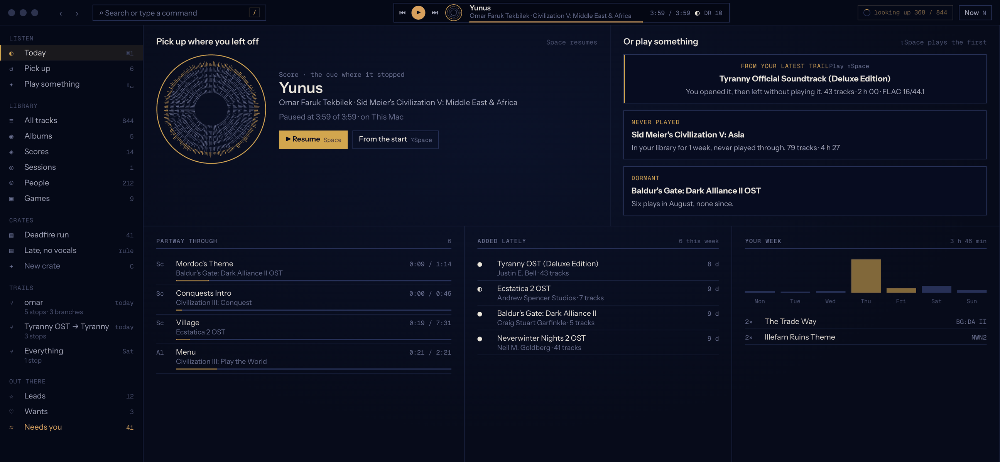

### A trail with its threads drawn

Home folds to a rail. Each pane keeps one width, its header is its star, and the thread you followed runs from the row you clicked to the pane it opened.

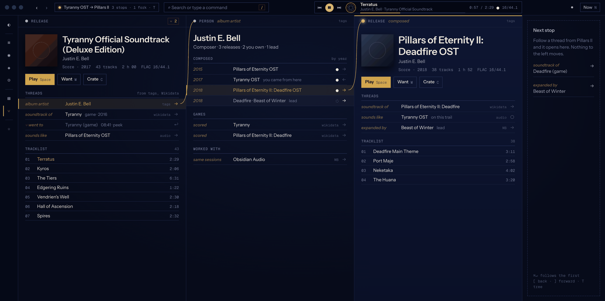

## Trails, 2026-10-13

### A trail on a large screen

2560 × 1440. Corridors of Time, its composer, Xenogears, the singer of its two vocal tracks and her band, with Now pinned on the right.

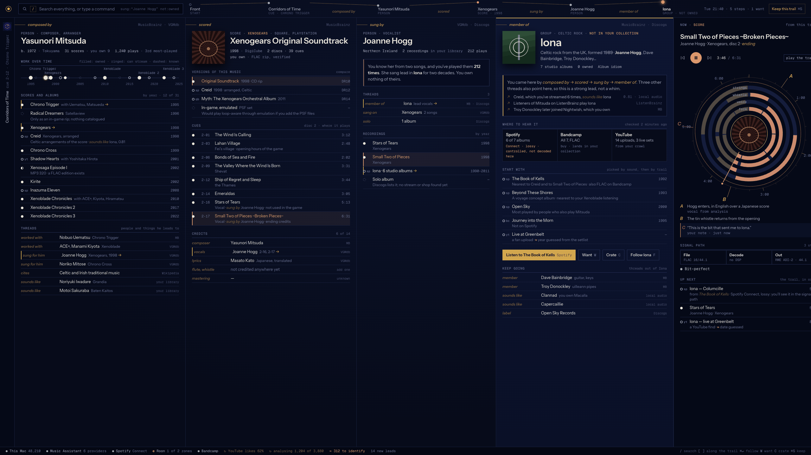

### The table

iTunes' one big table as a pane. Each numeric column header is a histogram you brush to filter, and rows group by release, work or person.

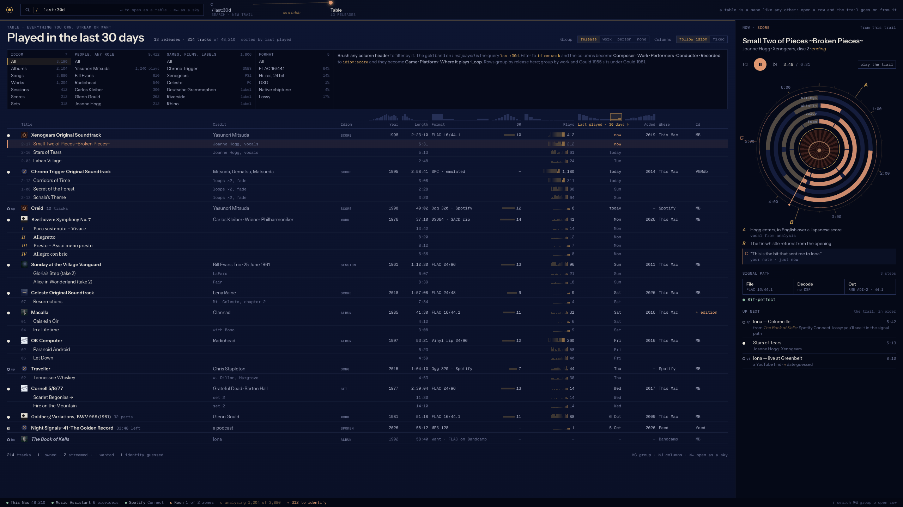

### The sky

The library placed by sound. Press `M` on a trail and its constellation unfolds onto it; leads are hollow stars, and a lasso turns a region into a table.

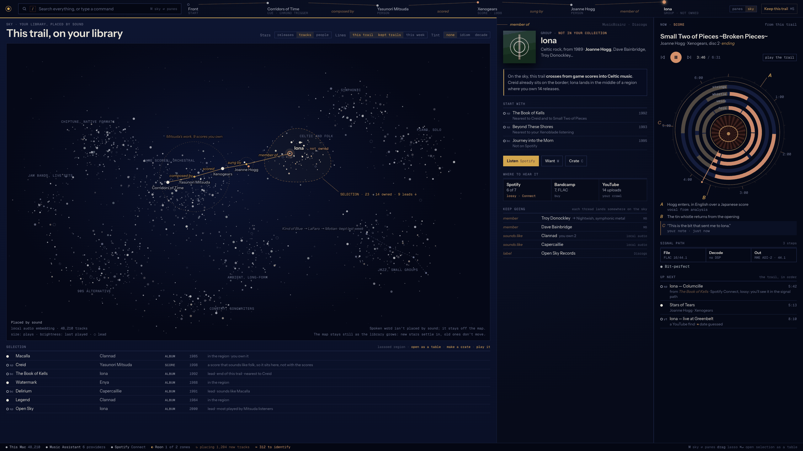

### The whole tree

Trails are trees. `T` shows every branch with its times, the peeks folded away, the point where two branches meet, and the same tree on the sky.

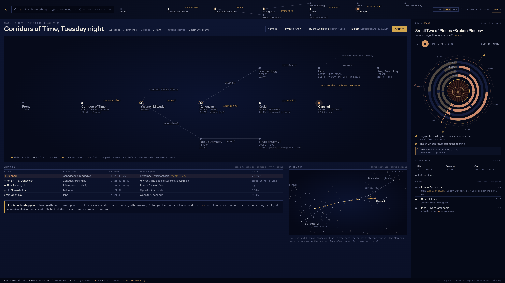

### Phone and foldable

The same trail. The phone shows one pane and swipes along the constellation; the unfolded foldable shows two.

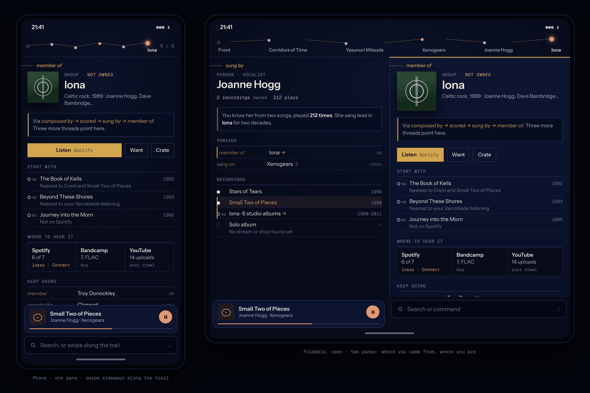

### Outside the app

The menu bar, media keys and the lock screen, where most plays start.

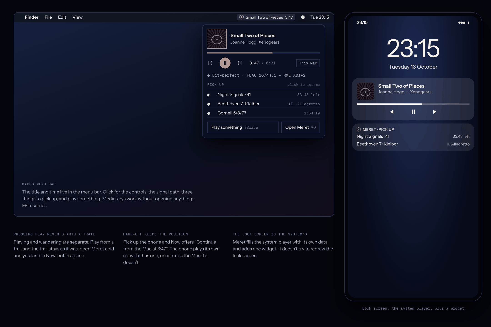

## Idioms, 2026-10-13

The shell stays put; per idiom, the page's lead, the track columns, the body drawing and a type register change. These plates predate the trail model, so their sidebar shell is gone; the idioms themselves still hold.

### Work

A release that holds two works leads with them, and recordings of the same work are compared movement by movement.

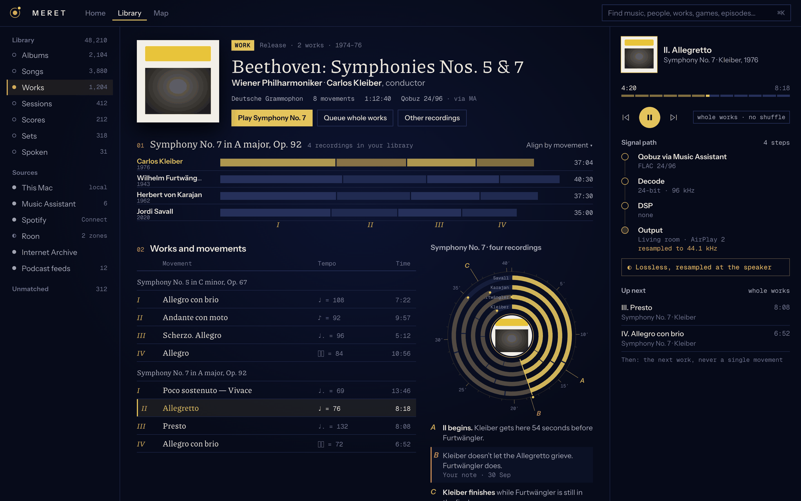

### Score

A game score leads with where the music is heard, and playback understands loops.

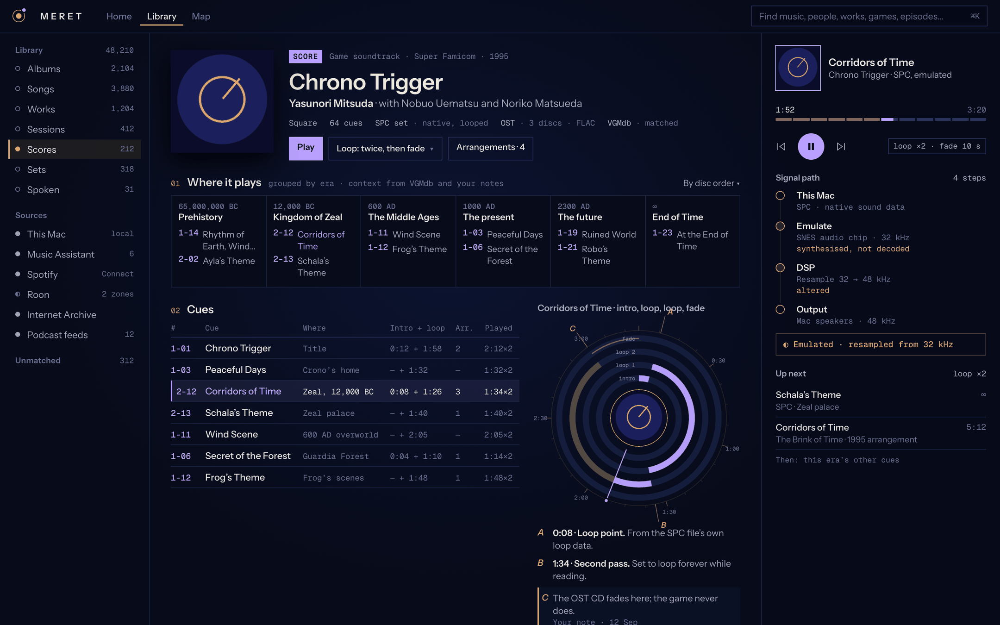

## Setup, 2026-10-14

### Settings › Playback

Settings is its own window. Volume stays at the DAC by default, and the signal path says whether output is bit-perfect.

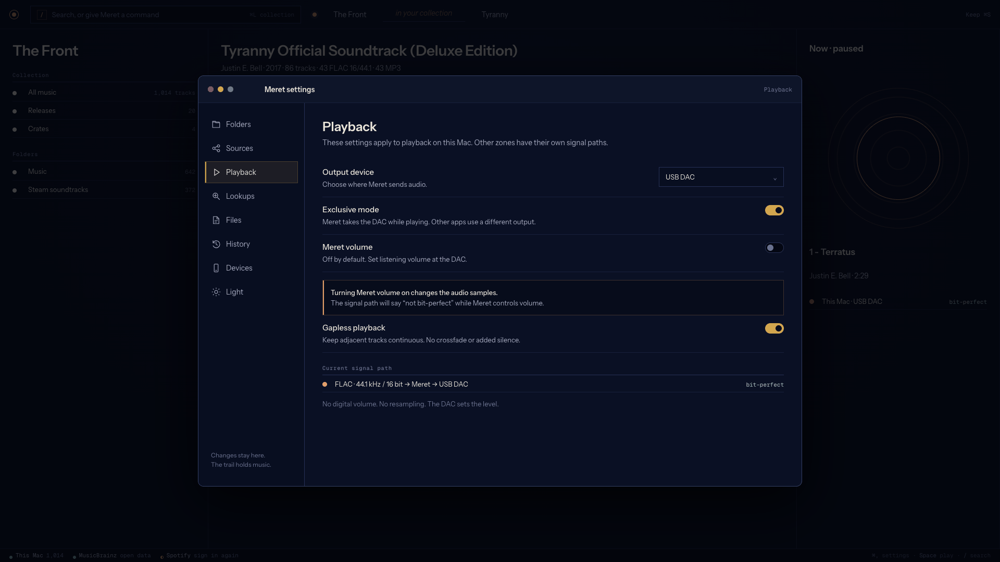
